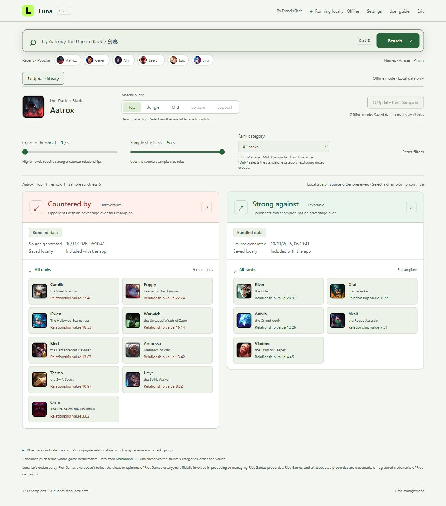

  

# Luna

**English** · [简体中文](README.zh-CN.md)

**v1.5.0** · Windows 10 / 11 · .NET Framework 4.7.2+ · [MIT — original code](LICENSE)

A local League of Legends matchup explorer for champion selection. Search for a champion to see **opponents that counter you** and **opponents you counter**, with lane and rank filters.

**Project home:** [Luna on GitHub](https://github.com/Francis-Chenyj/Luna-dev).

Switch instantly between English and Simplified Chinese in **Settings → General**; light, dark and system themes are available. The README, user guide and developer guide each have English and Simplified Chinese editions.

## Features

| Feature | What it does |
| --- | --- |
| Local queries | Reads the bundled default-profile library covering 173 champions and 428 supported champion–lane combinations. |
| Flexible search | Accepts Chinese and English names, titles, pinyin and curated nicknames. |
| Two-way results | Filters both matchup directions by lane, rank category, relationship threshold and sample strictness. |
| Background updates | Refreshes current and recent champions first; library downloads support resumption and fallback to saved data. |
| Settings and support | Persistent language/theme choices, startup data-update toggle, local folders and privacy-limited diagnostics. |
| Visible sources | Shows bundled, downloaded or fallback data, with source-generation and local-save times. |

Matchup results come from [MalzaharAI](https://www.malzaharai.top/counter). Relationship values are **not win rates**, and source timestamps are not game-patch dates.

## Preview

Luna 1.5.0 in English with the light theme, using bundled data: Aatrox, top lane, threshold 1, strictness 5, with the **全分段 (All ranks)** category selected. This is an interface example, not a live recommendation. [Screenshot details](docs/images/README.md).

## Download and quick start

**In development — pre-release.** Get `Luna-v1.5.0-Windows.zip` from [Releases](https://github.com/Francis-Chenyj/Luna-dev/releases). The separate `Luna-v1.5.0-Source.zip` contains no executable. Download `SHA256SUMS.txt` alongside the ZIP to verify its SHA-256 hash. Third-party distribution permissions and Riot registration remain open; see [release status](release-status.json) and [third-party notices](THIRD_PARTY_NOTICES.md).

**Requirements:** Windows 10 / 11, .NET Framework 4.7.2+ and a modern browser. Luna uses an Edge app window when available. Normal use needs no Node.js, Python, account, API key or administrator privileges.

After downloading the Windows package:

1. Extract the complete ZIP to a writable folder, such as `D:\Apps\Luna`.
2. Run **`Luna.exe`** or **`启动Luna.cmd`**.
3. Search for a champion, choose a lane and read the two matchup lists.

For use without external updates, run **`离线启动Luna.cmd`**. Installation, settings/data migration, shortcuts and troubleshooting are covered in the [user guide](docs/USER_GUIDE.md). Updating matchup data does not upgrade the Luna application.

## Documentation

| I want to… | Read |
| --- | --- |
| Install Luna, understand results or manage data | [User guide](docs/USER_GUIDE.md) |
| Build, test or package the source | [Developer guide](docs/DEVELOPER_GUIDE.md) |
| See what changed between versions | [Changelog](CHANGELOG.md) |
| Review data and asset notices | [Third-party notices](THIRD_PARTY_NOTICES.md) |

## Feedback

The [bug report](https://github.com/Francis-Chenyj/Luna-dev/issues/new?template=bug-report.yml) and [feature request](https://github.com/Francis-Chenyj/Luna-dev/issues/new?template=feature-request.yml) forms support English and Simplified Chinese. For a bug, include the Luna version, Windows version, steps, and expected/actual results. **Settings → Support → Copy diagnostics** provides a short summary; screenshots and relevant log excerpts are optional. Remove personal information before sharing.

## Author and acknowledgements

Created and maintained by [**FrancisChen**](https://github.com/Francis-Chenyj), with development assistance from [OpenAI Codex](https://openai.com/codex/).

The README layout draws on [Yifan Ad Skipper](https://github.com/CharryLee0426/yifan-ad-skipper). [League Akari](https://github.com/LeagueAkari/LeagueAkari) is a reference for GitHub project presentation; [Codex Team Token Tracker](https://github.com/CharryLee0426/codex_team_token_tracker) informed the separation of user and developer documentation.

## License

Copyright © 2026 FrancisChen. Luna's original code, scripts, documentation and green L icon use the [MIT License](LICENSE). Third-party game assets, upstream data and third-party content in screenshots retain their own terms; see [Third-party notices](THIRD_PARTY_NOTICES.md).

Luna isn't endorsed by Riot Games and doesn't reflect the views or opinions of Riot Games or anyone officially involved in producing or managing Riot Games properties. Riot Games, and all associated properties are trademarks or registered trademarks of Riot Games, Inc.
