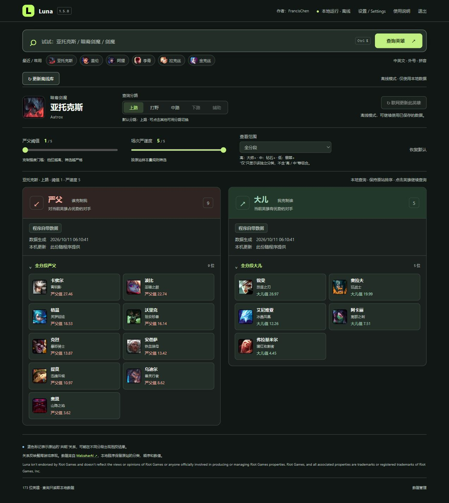

  

# Luna

[English](README.md) · **简体中文**

**v1.6.3** · Windows 10 / 11 · .NET Framework 4.7.2+ · [MIT — 原创代码](LICENSE)

用于英雄联盟选人阶段的本地对局查询工具。搜索英雄，即可查看 **严父（谁克制我）** 和 **大儿（我克制谁）**，并按分路与分段筛选结果。

**项目主页：**[Luna · GitHub](https://github.com/Francis-Chenyj/Luna-dev)。

在 **设置 → 常规** 中可即时切换简体中文 / English，选择深色、浅色或跟随系统。README、用户指南和开发指南均分别提供英文与简体中文版本。

## 功能

| 功能 | 说明 |
| --- | --- |
| 本地查询 | 默认条件离线库覆盖 173 位英雄、428 个有效英雄分路组合。 |
| 灵活搜索 | 支持中英文姓名、称号、拼音及整理的英雄外号。 |
| 双向关系 | 按分路、分段分类、克制阈值和场次严谨度筛选两侧结果。 |
| 后台更新 | 优先更新当前及最近英雄；整库下载支持断点续传，失败时回退到已保存的数据。 |
| 设置与排错 | 保存语言与主题偏好，设置启动数据更新，打开本地目录及复制精简诊断。 |
| 来源与时间 | 区分程序自带、联网下载和备用旧数据，显示原站生成时间与本机保存时间。 |

关系结果来自 [MalzaharAI](https://www.malzaharai.top/counter)。**关系值不是胜率**，数据生成时间也不是游戏补丁日期。

## 界面预览

Luna 1.5.0 简体中文、深色主题，使用随包数据：亚托克斯、上路、阈值 1、严谨度 5，查看范围选择“全分段”分类。此图用于展示界面，不代表实时推荐。[截图说明](docs/images/README.md)。

## 下载与快速开始

**1.6.3 本地修订：**修复升级记录损坏导致无法启动、维护与测试长路径问题、刷新丢失查看范围及英文无障碍文案；新增缺少条件时的单英雄下载入口、空间统计等待原因、原生界面健康检查和源码身份清单。此构建尚未上传 GitHub。详见 [1.6.3 发布说明](docs/RELEASE-v1.6.3.md)与[验证范围](docs/QA-1.6.3.md)。

**开发中 · 本地审阅版本。** 本次交付 `Luna-v1.6.3-Windows.zip`；`Luna-v1.6.3-Source.zip` 用于开发，不含可执行程序。[Releases 下载页](https://github.com/Francis-Chenyj/Luna-dev/releases)是独立的公开分发渠道，本地有新版不代表线上已发布。请用随包 `SHA256SUMS.txt` 核对 ZIP 的 SHA-256。第三方分发授权和 Riot 注册仍待完成，详见[分发状态](release-status.json)与[第三方声明](THIRD_PARTY_NOTICES.md)。

**运行要求：** Windows 10 / 11、.NET Framework 4.7.2 或更高版本，以及 Microsoft Edge WebView2 Runtime。Luna 复用已安装的运行环境，不打包完整浏览器。缺少时请安装[微软 Evergreen Runtime](https://developer.microsoft.com/microsoft-edge/webview2/)。`Luna.exe --browser` 可使用浏览器兼容模式，但不支持托盘。普通使用无需 Node.js、Python、账号、API Key 或管理员权限。

下载 Windows 运行包后：

1. 将完整 ZIP 解压到可写目录，例如 `D:\Apps\Luna`。
2. 双击 **`Luna.exe`** 或 **`启动Luna.cmd`**。
3. 搜索英雄、选择分路，查看两侧克制列表。

需要禁止外网更新时，运行 **`离线启动Luna.cmd`**。安装、设置与数据迁移、快捷方式和故障处理见[用户指南](docs/USER_GUIDE.zh-CN.md)。更新对局数据不会升级 Luna 程序本身。

## 关闭与托盘

初次点击标题栏 **×** 或按 **Alt+F4** 时，可选择“最小化到托盘区”或“退出应用”，也可勾选“记住我的选择”。以后在 **设置 → 常规 → 关闭窗口时** 更改，或改回“每次询问”。

最小化到托盘后，已经开始的数据更新继续运行。双击托盘的绿色 **L**、右键选择“打开 Luna”，或再次打开同一快捷方式，即可恢复原窗口和查询。页面及托盘菜单里的“退出”始终会结束 Luna 和后台更新，已经保存的下载数据下次仍可用。

从旧版本首次升级时，先真正退出 Luna，再完整解压新运行包并保留原有 `cache`；也可以将旧 `cache` 复制到新运行包目录。原有语言、主题与离线数据继续使用。旧 Edge 窗口的最近搜索不自动迁移；新窗口记录保存在 `cache/webview2`。浏览器兼容模式保留原来的闲置超时规则。

## 启动与空间管理

启动先读取关系库清单，不再逐条校验所有组合及备份。每次查询仍验证对应记录，损坏时尝试原有备用数据；其余检查在后台分批进行并保存进度。不会因查询而等待联网。

**设置 → 数据 → 空间管理**显示程序核心与自带数据、离线库、英雄更新、界面存储、程序更新与回退备份、日志和其他运行文件。数字有检查时间；不包含源码、额外放入的文件或系统共享运行环境，也不是内存用量。

- 正常英雄更新缓存保留最多 64 组、8 MiB；完整库每种组合保留当前与上一份可用版本。
- 确认损坏的英雄缓存及损坏设置备份进入隔离区，最多 20 份、合计 10 MiB、保留 7 天。
- 未完成数据下载和程序更新暂存，7 天无进展后可清理。程序回退只保留一份旧版。
- 界面可再生成的缓存每天在空闲时清理，保留最近查询与设置。手动整理也不会清空离线库。
- 文件占用、归属不明、启用记录损坏或可能是最后一份可恢复数据时，采取保守保留；所以以上限额不是整个目录的硬上限。

运行包约 **9.1 MiB**，未产生用户缓存时解压文件约 **10.6 MiB**。本次原生窗口试用中，程序核心与初期运行存储统计约 21 MiB；界面存储、下载的关系库及程序回退备份会增加占用。具体以空间页的实测数和检查时间为准，不按使用月数线性增长。

1.6.0 已进行了六轮每次 30 秒的使用测试：更新记录跨次增加 **40 → 88 → 136 条**，跨次重复下载为 0。1,141 次本地查询全部成功，本机最慢 17.91 ms。更新响应使用受控样本，这些数值不代表公网速度或所有电脑的保证。详见[完整验证记录](docs/QA-1.6.0.md)。

## 程序更新

**设置 → 应用**与“更新离线库”分开。自动检查默认开启，自动下载默认关闭，无需登录 GitHub。只接受版本号更高、签名有效的正式发布包，不下载仓库最新源码或预发布版本。

| 用户操作 | 实际行为 |
| --- | --- |
| 开启自动下载 | 一次保存两个开关，立即在后台检查；存在符合要求的新版时自动下载，无需再点检查按钮。 |
| 开启自动检查 | 立即检查；仅在自动下载也开启时才自动下载。 |
| 关闭自动检查 | 同时关闭自动下载，停止自动任务，保留已下载进度。 |
| 单独关闭自动下载 | 暂停自动下载，保留版本检查和已下载内容。 |
| 手动点击检查或下载 | 自动检查关闭时仍可使用；关闭自动开关不会取消用户明确点击的手动下载。 |

已有检查或下载任务会复用，不重复启动。关闭后立即重开时，会等旧任务停止，再进行一次检查，不会漏掉请求。应用设置即时显示保存提示和当前进度；联网失败不会撤销设置，也不影响本地查询。

之后每次普通启动约 8 秒后判断检查间隔：距上次成功检查至少 24 小时，且距上次尝试至少一小时才自动再查。无需检查时，自动下载开启可接续已保存的新版本下载。这是启动调度，不是持续运行中的定时轮询。手动检查或重新开启开关不受上述间隔限制。点击暂停后，本次启动尚未执行的后台任务不会又把它开启；手动继续或重新启用可恢复。

离线启动时仍可保存开关，但不发起任何程序更新请求；`--no-auto-update` 启动也会禁止本次后台更新，包括开启开关触发的自动任务，但允许手动检查。界面会说明原因，下次普通启动遵循已保存的设置。

启用自动下载或点击“下载新版”后，已写入的部分跨启动保留；服务器支持时使用 HTTP Range 接续。源不支持续传时安全重新下载，不能保证每个下载服务器都支持断点。文件校验完成后不重复下载。只有点击 **重启并更新** 并确认才安装；最小化到托盘不等于退出或安装。

成功重启后，应用设置显示更新成功，不再提示旧的“发现新版”。健康检查现在要求原生窗口、界面初始化和本地查询一起通过；故障恢复与本次实际验收范围见 [QA](docs/QA-1.6.3.md)。历史短会话测试保留原版本记录，不代表本次执行了公网发布升级。

程序只接受项目正式发布源中经内置公钥验证的更新说明，并验证 ZIP 大小、SHA-256、文件清单和路径。新版本通过本地启动与查询检查后启用；检查失败恢复旧程序。升级过程中意外中断，可再次启动恢复。设置及离线库不参与程序文件替换。

**发布前提：**维护者必须先在 GitHub 正式 Release 中提供 Windows ZIP 与配套 `luna-update.json`。本地打包或签名不等于已发布。尚无兼容正式版本、网络失败时继续使用当前版本，不会显示为已成功更新。源码目录不能自动覆盖；可从更新文件夹取出完整 ZIP 手动部署。

## 可选安装与卸载

便携运行无需安装。想在 Windows“已安装的应用”中管理 Luna，可运行包内 **安装Luna.cmd**，选择新的空文件夹；安装仅面向当前用户，保留原便携副本，通过开始菜单启动。

在 **设置 → 应用 → 卸载 Luna** 中可移除此副本；安装版也可通过 Windows 应用列表卸载。默认保留 `cache` 中的用户数据，程序更新暂存与回退备份会移除；可勾选同时删除设置、离线数据和最近查询。先退出同目录的其他 Luna 实例。修改过的程序文件、额外文件和其他目录的副本会保留；不卸载 Edge、WebView2 或 .NET。含源码的目录禁止卸载。

## 文档导航

| 想了解什么 | 阅读位置 |
| --- | --- |
| 安装使用、理解结果、管理数据 | [用户指南](docs/USER_GUIDE.zh-CN.md) |
| 构建、测试、打包源码 | [开发指南](docs/DEVELOPER_GUIDE.zh-CN.md) |
| 各版本发生了哪些变化 | [更新日志](CHANGELOG.md) |
| 数据与素材的来源和声明 | [第三方声明](THIRD_PARTY_NOTICES.md) |

## 问题反馈

支持中英文的[错误反馈](https://github.com/Francis-Chenyj/Luna-dev/issues/new?template=bug-report.yml)与[功能建议](https://github.com/Francis-Chenyj/Luna-dev/issues/new?template=feature-request.yml)表单用于收集反馈。错误反馈请填写 Luna 版本、Windows 版本、复现步骤、预期与实际结果。可使用 **设置 → 排错 → 复制诊断信息** 提供简短摘要，截图与相关日志片段为可选项，分享前请移除个人信息。

## 作者与致谢

由 [**FrancisChen**](https://github.com/Francis-Chenyj) 创建和维护，开发过程中使用 [OpenAI Codex](https://openai.com/codex/) 辅助。

README 排版参考 [Yifan Ad Skipper](https://github.com/CharryLee0426/yifan-ad-skipper)。[League Akari](https://github.com/LeagueAkari/LeagueAkari) 为 GitHub 项目展示提供参考；[Codex Team Token Tracker](https://github.com/CharryLee0426/codex_team_token_tracker) 为用户与开发文档的分层提供参考。

## 许可证

Copyright © 2026 FrancisChen。Luna 的原创代码、脚本、说明和绿色 L 图标采用 [MIT 许可证](LICENSE)。第三方游戏素材、上游数据及截图中的第三方内容仍适用各自条款，详见[第三方声明](THIRD_PARTY_NOTICES.md)。

Luna 未获 Riot Games 官方认可，也不代表 Riot Games 或参与制作、管理其产品的相关人员的观点。Riot Games 及其相关名称和标志的权利归各自权利人。
